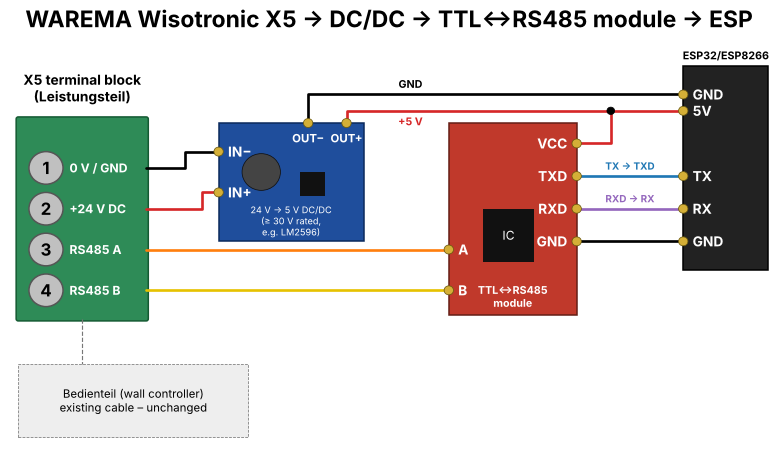

# Wisotronic RS485 Protocol Notes

Findings from reverse-engineering the Wisotronic bus.

## Status

The protocol analysis is based on a single installation (see hardware list below).

It is therefore most probably not complete and may contain errors or assumptions due to lack of
other systems to compare to. The protocol description below is based on the most commonly
received data packets, under the assumption that packets with very uncommon start bytes or lengths
were transmission errors.

## Hardware

List of tested hardware components this library supports (at least partially):

* Wisotronic dialog 3-Kanal Zentrale EWFS-UP (#1002 566)
* Messwertgeber Wind/Photo/Funkuhr (#623 021)
* Messwertgeber Niederschlag (#1002 325)
* Messwertgeber Temperatur aussen (#628 145)
* Messwertgeber Temperatur/Luftfeuchte (#628 147)

### Hardware Connection (X5 Terminal Block on Leistungsteil)

The ESPHome device connects to the **X5 terminal block** on the Wisotronic Leistungsteil
(power unit):



**ESPHome Device Connections:**
- **Power**: 24V DC from X5 pin 2 (+) and pin 1 (GND) → 24V→5V DC/DC converter → ESP32/ESP8266
- **RS485**: X5 pin 1 (GND), pin 3 (A), pin 4 (B) → RS485-to-TTL module (MAX485/SN65HVD75) → ESP UART
- **⚠️ Do not add a 120 Ω termination resistor** — the Leistungsteil already contains the required bus termination internally.
- **Cable**: Keep existing JY(St)Y 2×2×0.8 mm² between X5 pins 1–4 and Bedienteil (wall controller)

## Physical layer (as configured in ESPHome `.yaml` file)

- RS485 half-duplex.
- Baud rate 19200, 8N1.
- Protocol is bus-level broadcast/loopback: frames flow continuously, no request/response
  timing handshake.

## Frame format (confirmed)

Each frame:

```
[0]     0x23                    magic start byte
[1]     class                  0x00 (controller / temp) or 0xfd (station / covers)
[2]     direction/addr         0x00 / 0xfd (polls), 0xff (data frames)   [approx]
[3]     0x1c (data) / 0x10 (poll)
[4]     0x10 (data) / 0x01 (poll)
[5]     0x01
[6]     0x00
[7]     dataset id              0x01 / 0x02 / 0x03                            [data]
[8]     L                        payload length                                [data]
[9..9+L-1] TLV payload
[9+L]   checksum                additive sum of all previous bytes mod 256
```

- Data frame total length = `L + 10`. Validated: len 22 -> L=12, len 46 -> L=36, len 58 -> L=48.
- Poll frame (11 bytes, class 0x00): `23 00 <00|fd> 10 01 <01|02|03> 00 00 00 00 CS`,
  where byte 5 is the requested dataset (1 -> 22 B, 2 -> 46 B, 3 -> 58 B).
- Checksum = sum of all bytes before the last byte, modulo 256 (uint8 wraparound). Validated
  against every frame (10,959 of 10,960 checksum-valid frames passed).
- Frames are back-to-back; the next frame's leading `0x23` terminates the previous one.

## Payload structure

Payload is a TLV chain: `[tag][length][value bytes...]`, with the tag/length/value chain
consuming exactly `L` bytes. Validated over all 10,970 data frames: 0 parse failures, 0
length mismatches.

### Frame type overview

| Frame | Class | Dataset | Size | Direction | Description |
|---|---|---|---|---|---|
| Poll | 0x00 | 1/2/3 | 11 B | 0x00/0xfd | Controller requests dataset |
| Sensor/Temp | 0x00 | 1 | 22 B | 0xff | Indoor sensors |
| Blind Status | 0xFD | 1 | 22 B | 0xff | Blind position/tilt |
| Covers + Wind | 0xFD | 2 | 46 B | 0xff | Cover channels + wind |
| Full Weather | 0xFD | 3 | 58 B | 0xff | All weather sensors |

## TLV Tag Inventory by Frame Type

### Poll Frame (11 B, Class 0x00, Dataset 1/2/3)

No TLV payload. Byte 5 selects dataset to request.

### Sensor/Temp Frame (22 B, Class 0x00, Dataset 1)

| Tag | Len | Status | Meaning | Scaling / Formula |
|---|---|---|---|---|
| 0x00 | 1 | ✅ KNOWN | Control unit temperature raw | `°C = value/2 - 25` |
| 0x01 | 1 | ❓ UNKNOWN | Always 0x00 | — |
| 0x02 | 1 | ❓ UNKNOWN | Always 0x00 | — |
| 0x03 | 1 | ❓ UNKNOWN | Always 0x00 | — |

### Blind Status Frame (22 B, Class 0xFD, Dataset 1)

| Tag | Len | Status | Meaning | Scaling / Formula |
|---|---|---|---|---|
| 0x12 | 1 | ✅ KNOWN | Blind 1 position | `pos = 1 - value/200` (0=open..1=closed) |
| 0x13 | 1 | ✅ KNOWN | Blind 1 tilt | `tilt = 0.5 - int8(value)/160` (-80..80) |
| 0x14 | 1 | ✅ KNOWN | Blind 2 position | `pos = 1 - value/200` |
| 0x15 | 1 | ✅ KNOWN | Blind 2 tilt | `tilt = 0.5 - int8(value)/160` |

### Covers + Wind Frame (46 B, Class 0xFD, Dataset 2)

| Tag | Len | Status | Meaning | Scaling / Formula |
|---|---|---|---|---|
| 0x00 | 6 | ✅ KNOWN | Awning cover block | `28 08 <pos> <tilt> <pos2> <tilt2>` |
| 0x01 | 6 | ✅ KNOWN | Window cover block | `0A 09 <pos> <tilt=0> <pos2> <tilt2=0>` — no tilt, linear actuator only |
| 0x02 | 6 | ❓ UNKNOWN | Unknown block | `28 08 <val> <val> <val> <val>` |
| 0x03 | 1 | ✅ KNOWN | Wind speed | `m/s = value/5.0` |
| 0x11 | 7 | ✅ KNOWN | **Full timestamp** | See below |

**Tag 0x11 (Timestamp) — 7 bytes:**

| Byte | Field | Encoding |
|---|---|---|
| 0 | Seconds | 0–59 (uint8) |
| 1 | Minutes | 0–59 (uint8) |
| 2 | Hour + flags | bits 5–0 = hour (0–63), bit 6 = version (1), bit 7 = DST (1 = summer) |
| 3 | Weekday | 0 = Sun … 6 = Sat |
| 4 | Day | 1–31 |
| 5 | Month | 1–12 |
| 6 | Year-2000 | 0–99 |

*Validated against 2023-04-11 (DST active, 0xCF) and 2026-11-19 (standard time, 0x4B/4C/4F) captures.*

### Full Weather Frame (58 B, Class 0xFD, Dataset 3)

| Tag | Len | Status | Meaning | Scaling / Formula |
|---|---|---|---|---|
| 0x04 | 1 | ✅ KNOWN | Rain (bool) | 0 = none, 1 = rain |
| 0x05 | 1 | ✅ KNOWN | Indoor temperature | `°C = value/2 - 25` |
| 0x06 | 1 | ❓ UNKNOWN | Always 0x00 | — |
| 0x07 | 1 | ❓ UNKNOWN | Always 0x00 | — |
| 0x08 | 1 | ✅ KNOWN | Outdoor temperature | `°C = value/2 - 25` |
| 0x09 | 1 | ✅ KNOWN | Humidity | `% = value/2` |
| 0x0A | 1 | ✅ KNOWN | Photo 1 brightness | `lx = value/2 * 1000` |
| 0x0B | 1 | ✅ KNOWN | Photo 2 brightness | `lx = value/2 * 1000` |
| 0x0C | 1 | ✅ KNOWN | Photo 3 brightness | `lx = value/2 * 1000` |
| 0x0D | 1 | ✅ KNOWN | Twilight brightness | `lx = value * 2` |
| 0x0E | 3 | ❓ VAGUE | Constant `07 00 80` | Firmware/capability ID? |
| 0x0F | 3 | ❓ VAGUE | Constant `07 00 80` | Same as 0x0E |
| 0x10 | 3 | ❓ VAGUE | Constant `07 00 80` | Same as 0x0E/0x0F |
| 0x16 | 1 | ❓ VAGUE | Constant `0x07` | Protocol sub-version? |

## Field Mapping Summary (Decoded + Scaling)

Notation: `int` = raw integer from device (0–255), `physical` = scaled engineering value.

### Temperature / Humidity / Brightness (all single-byte tags)

| Tag | Frame | int → physical | Unit |
|---|---|---|---|
| 0x00 (class 0x00) | 22 B | `physical = int/2 - 25` | °C |
| 0x05 (class 0xFD) | 58 B | `physical = int/2 - 25` | °C |
| 0x08 (class 0xFD) | 58 B | `physical = int/2 - 25` | °C |
| 0x09 (class 0xFD) | 58 B | `physical = int/2` | % |
| 0x0A, 0x0B, 0x0C (class 0xFD) | 58 B | `physical = int/2 * 1000` | lx |
| 0x0D (class 0xFD) | 58 B | `physical = int * 2` | lx |

### Wind / Rain

| Tag | Frame | int → physical | Unit |
|---|---|---|---|
| 0x03 (class 0xFD) | 46 B | `physical = int/5.0` | m/s |
| 0x04 (class 0xFD) | 58 B | `physical = int` (0/1) | bool |

### Cover Position / Tilt

| Tag | Frame | int → physical | Range | Notes |
|---|---|---|---|---|
| 0x00 (46 B, byte 2) | 46 B | `physical = 1 - int/200` | 0=open..1=closed | Awning |
| 0x01 (46 B, byte 2) | 46 B | `physical = int/200` | 0=open..1=closed | Window — **no tilt** (linear actuator) |
| 0x12, 0x14 (class 0xFD) | 22 B | `physical = 1 - int/200` | 0=open..1=closed | Blind 1/2 position |
| 0x13, 0x15 (class 0xFD) | 22 B | `physical = 0.5 - int8(int)/160` | -80..80 | Blind 1/2 tilt |

### Timestamp (Tag 0x11, len 7, 46 B frame)

| Byte | Field | Encoding |
|---|---|---|
| 0 | Seconds | 0–59 (uint8) |
| 1 | Minutes | 0–59 (uint8) |
| 2 | Hour + flags | bits 5–0 = hour (0–63), bit 6 = version (1), bit 7 = DST (1 = summer) |
| 3 | Weekday | 0 = Sun … 6 = Sat |
| 4 | Day | 1–31 |
| 5 | Month | 1–12 |
| 6 | Year-2000 | 0–99 |

## Uncovered / Missing Data

1. **Poll frames (11 B)** — not handled (poll frames)
2. **22 B Class 0x00 tags 0x01/0x02/0x03** — always zero; reserved?
3. **22 B Class 0xFD tags 0x12–0x15** — blind status; were silently ignored in old parser
4. **58 B tags 0x06/0x07** — always zero; additional sensors?
5. **58 B tags 0x0E/0x0F/0x10** — constant `07 00 80`; firmware/capability ID?
6. **58 B tag 0x16** — constant `0x07`; protocol sub-version?
7. **46 B tag 0x02** — unknown block (6 bytes)

## Parser Implications

- Replace magic-byte resynchronization (`0x23` + last-two-byte check) with a length-field
  driven parser (use byte 8; total = byte8 + 10) + additive checksum validation.
- Parse payloads as TLV chains (tag/length/value) rather than fixed offsets; validate that the
  TLV chain consumes exactly the declared payload length.
- Route frames by (class, dataset) and map responses back to the requesting poll.

## Cover Control Frames (TX)

Control frames are sent to command cover movement. The frame format follows the standard
data frame layout with class `0xfd` (covers), direction `0xff` (data), dataset `0x02`:

```
[0]     0x23                    magic start byte
[1]     0xfd                    class (covers)
[2]     0xff                    direction (data)
[3]     0x1c                    frame type (data)
[4]     0x10                    data flag
[5]     0x01                    dataset
[6]     0x00                    dataset selector
[7]     0x02                    dataset id (covers)
[8]     L                       payload length (8 for single block TLV)
[9]     tag                     cover tag: 0x00=awning, 0x01=window, 0x02=blinds
[10]    0x06                    block length (always 6)
[11]    block_type              0x28=stopped, 0x0a=moving
[12]    sub_type                0x08=stopped, 0x01=moving-down, 0x09=moving-up
[13]    position                0=open, 200=closed
[14]    tilt                    -80 to 80 (signed 8-bit)
[15]    pos2                    0 (unused)
[16]    tilt2                   0 (unused)
[17]    checksum                additive sum of bytes [0..16]
```

Control command mapping:
- **OPEN**: block_type=0x0a, sub_type=0x09, position=0, tilt=0
- **CLOSE**: block_type=0x0a, sub_type=0x01, position=200, tilt=0
- **STOP**: block_type=0x28, sub_type=0x08, position=0, tilt=0
- **TILT**: block_type=0x28, sub_type=0x08, position=0, tilt=(-80..80)

The TLV payload for covers is always 8 bytes (tag + len + 6 block bytes), so L is
always 8 for single-block control frames.
